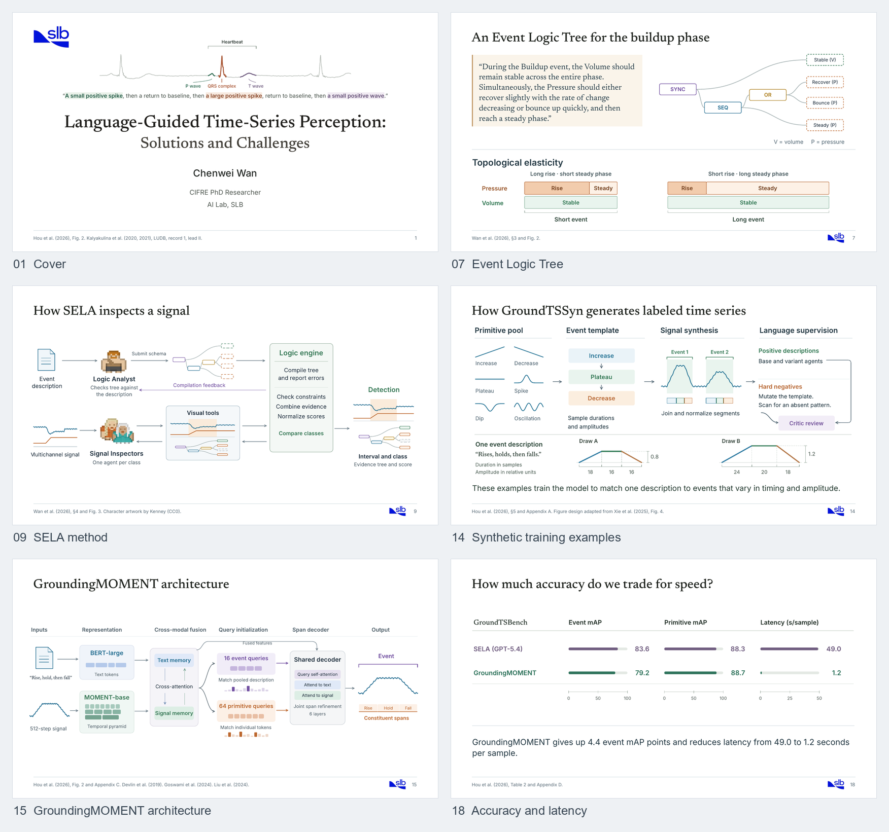

# Elegant Academic Slides Skill

[中文说明](README.zh-CN.md) · [Install](https://github.com/cw-wan/elegant-academic-slides-skill/releases/latest) · [Examples](examples/README.md) · [Resources](docs/resources.md) · [Changelog](CHANGELOG.md)

Create academic talks and industrial research seminars with a clear scientific story, precise diagrams, readable evidence, and editable presentation content.

The current repository release is **v0.2.0**, based on the submitted skill edition **v2026.11.25.3**. The project maintains the **`design-academic-slides`** skill, installable releases, and examples archived by release version.

## See the example

[](examples/v0.2.0/slb-webinar-2026-11-25/README.md)

**[Language-Guided Time-Series Perception: Solutions and Challenges](examples/v0.2.0/slb-webinar-2026-11-25/README.md)** is a supplied 23-slide English seminar by Chenwei Wan for the SLB AI Lab Webinar, dated 25 November 2026. Open the example for its PowerPoint, PDF, original design record, and full-size previews. These images are rendered from the supplied PDF.

## What it helps with

- Organize one or several papers around the audience's question.
- Preserve the author's argument, scientific terms, numerical values, and evaluation conditions.
- Draw method figures, logic trees, time-series annotations, and result comparisons.
- Use Newsreader for titles and Inter for body text, labels, tables, and references, subject to the user's brief or template.
- Refine scientific English and select useful visible annotations.
- Apply comments to the latest accepted version and verify exported presentations.

This is an **instruction and reference package**. Actual PPTX creation, editing, rendering, and export depend on tools available in the host agent environment. No rendering engine or presentation library is bundled.

## Install

### Install a release

Open the [latest release](https://github.com/cw-wan/elegant-academic-slides-skill/releases/latest). For v0.2.0:

| Asset | Purpose |
| --- | --- |
| **`design-academic-slides-v0.2.0.zip`** | Recommended installation package, reviewed for this repository release |
| `design-academic-slides_v2026.11.25.3.zip` | Unmodified submitted package, retained for provenance |
| `SHA256SUMS.txt` | SHA-256 checksums for both ZIP files |

Extract the **recommended package** and copy its `design-academic-slides/` folder into your Codex project's `.agents/skills/` directory:

```text
your-project/
└── .agents/
    └── skills/
        └── design-academic-slides/
            ├── SKILL.md
            ├── agents/
            ├── assets/
            └── references/
```

The installation ZIP contains the skill and its six selected SVG figures. Full presentation examples and repository documentation stay in the main project. GitHub's automatically generated source archives contain the full repository.

### Install from source with Codex

Ask Codex:

```text
Use $skill-installer to install the skill at
https://github.com/cw-wan/elegant-academic-slides-skill/tree/main/skills/design-academic-slides
```

You can also clone the repository and copy `skills/design-academic-slides/` into your project's `.agents/skills/` directory. Keep the internal invocation name **`$design-academic-slides`**. If it does not appear after installation, restart Codex. See the [official skill documentation](https://learn.chatgpt.com/docs/build-skills) for supported locations.

For another agent that supports `SKILL.md`, follow its installation workflow and provide suitable presentation tools.

## Use

Supply the paper, data, existing deck, or comments needed for your task.

**Paper to talk**

```text
Use $design-academic-slides to turn the attached paper into a 12-slide,
15-minute conference talk in English. Deliver an editable PPTX. Explain
the task, method, main evidence, and limitations using the supplied sources.
```

**Revise an existing deck**

```text
Use $design-academic-slides to apply these comments to the attached deck.
Enlarge the method figure, clarify its feedback arrows, and improve the
results chart labels. Preserve the scientific values and unrelated slides.
```

**Chinese research update**

```text
使用 $design-academic-slides，把这些实验结果整理成 3 页中文组会汇报：
研究问题、方法概览、主要结果。保留准确的指标和实验设置，输出可编辑 PPTX。
```

## Package and project

The skill contains 18 files: its entry point, UI metadata, icon, nine reference guides, and six editable SVG examples.

| Resource | Purpose |
| --- | --- |
| [SKILL.md](skills/design-academic-slides/SKILL.md) | Entry point and task routing |
| [Scientific content](skills/design-academic-slides/references/scientific-content.md) | Audience questions, seminar structure, and evidence |
| [Visual design](skills/design-academic-slides/references/visual-design.md) | Typography, covers, authorship, and branding |
| [Writing and annotations](skills/design-academic-slides/references/writing-and-annotations.md) | Scientific English and visible annotations |
| [Scientific diagrams](skills/design-academic-slides/references/scientific-diagrams.md) | Methods, logic trees, intervals, and synthetic examples |
| [Experimental evidence](skills/design-academic-slides/references/experimental-evidence.md) | Metrics, thresholds, tables, and latency |
| [Revision and delivery](skills/design-academic-slides/references/revision-and-delivery.md) | Reviews, fonts, exports, and verification |
| [SELA seminar profile](skills/design-academic-slides/references/sela-profile.md) | Optional SELA and GroundingMOMENT guidance |
| [Sources and attribution](skills/design-academic-slides/references/sources.md) | Sources connected to the skill's working practices |
| [Chinese handbook](skills/design-academic-slides/references/guide.zh-CN.md) | Explanations and worked examples in Chinese |
| [SVG examples](skills/design-academic-slides/assets/examples/) | Six selected editable seminar figures |
| [External resources](docs/resources.md) | External skills, papers, data, fonts, and presentation references |

The SELA profile applies to its named project or an explicit request to reuse that design. External skills are separately maintained references, not mandatory dependencies.

```text
elegant-academic-slides-skill/
├── README.md
├── README.zh-CN.md
├── CHANGELOG.md
├── skills/design-academic-slides/
├── examples/
│   ├── README.md
│   └── v0.2.0/slb-webinar-2026-11-25/
│       ├── SLB-Webinar-261125.pptx
│       ├── SLB-Webinar-261125.pdf
│       ├── Seminar_Writing_Design_and_Sources_v10.md
│       ├── example.json
│       └── previews/
├── docs/resources.md
└── scripts/package_skill.py
```

See the [example index](examples/README.md) for the versioned archive layout. The prior [v0.1.0 release](https://github.com/cw-wan/elegant-academic-slides-skill/releases/tag/v0.1.0) remains available.

## Build a release package

With Python 3.10 or later, run from the repository root:

```sh
python scripts/package_skill.py v0.2.0
```

This writes `dist/design-academic-slides-v0.2.0.zip` and `dist/SHA256SUMS.txt`. To retain an original submitted package alongside the reviewed package, add `--source-archive PATH`. Generated packages are ignored by Git and distributed as Release assets.

## Scope and license

The skill focuses on academic talks and research seminars. Editable output and validation depend on the host environment's tools. This update was checked against the supplied seminar design record; see the [changelog](CHANGELOG.md) for release changes.

No repository `LICENSE` file has been added. Third-party sources are recorded in the [resource catalog](docs/resources.md) and original design record.
