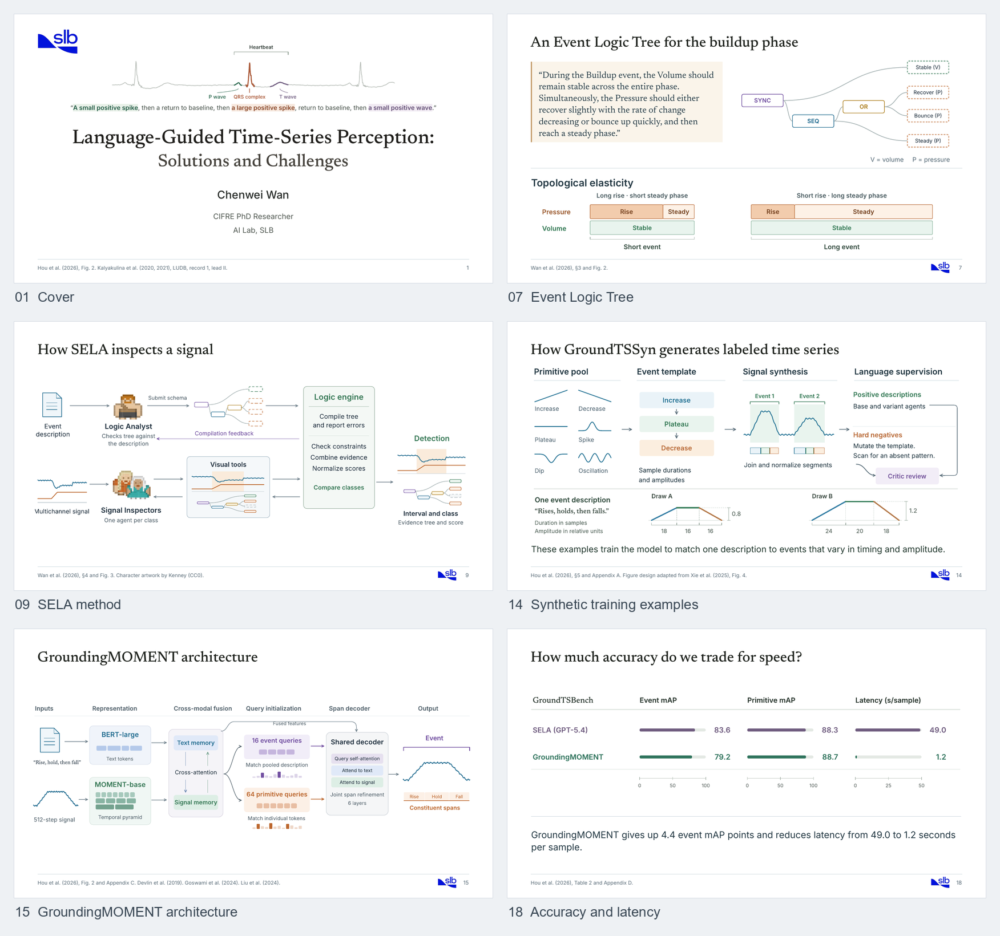

# Elegant Academic Slides Skill

[English](README.md) · [安装](https://github.com/cw-wan/elegant-academic-slides-skill/releases/latest) · [范例目录](examples/README.md) · [资源清单](docs/resources.md) · [更新记录](CHANGELOG.md)

面向论文报告、学术会议、组会和工业研究研讨会的演示文稿 skill：组织清楚的科研叙事，绘制准确的方法图，呈现可读的实验证据，并保留内容的可编辑性。

当前仓库版本为 **v0.2.0**，基于提交的 skill edition **v2026.11.25.3**。本项目维护 **`design-academic-slides`** 源码、可安装包和按发布版本归档的实际范例。

## 查看实际效果

[](examples/v0.2.0/slb-webinar-2026-11-25/README.md)

**[Language-Guided Time-Series Perception: Solutions and Challenges](examples/v0.2.0/slb-webinar-2026-11-25/README.md)** 是 Chenwei Wan 于 2026 年 11 月 25 日为 SLB AI Lab Webinar 准备的 23 页英文报告。范例页提供 PowerPoint、PDF、设计原文和完整尺寸预览；上图直接从提供的 PDF 渲染。

## 可以做什么

- 围绕听众的问题组织单篇或多篇论文，明确任务、方法、证据和研究方向。
- 保留作者论证、科学术语、数值与实验条件，区分结果、解释和提案。
- 制作方法图、逻辑树、时序区间标注及实验比较。
- 优先使用 Newsreader 作为标题字体，Inter 用于正文、标签、表格和参考文献，同时服从用户要求与模板约束。
- 修改学术英语和可见标注，减少重复叙述和制作过程说明。
- 按批注局部修改最新接受的版本，检查字体、导出、备注和媒体。

这是一个**规范与指令型 skill**。实际 PPTX 创建、编辑、导出和渲染依赖所在 agent 环境提供的工具；包内不附带渲染引擎或演示文稿库。

## 安装

### 推荐：从 Release 安装

打开 [最新 Release](https://github.com/cw-wan/elegant-academic-slides-skill/releases/latest)。v0.2.0 包含：

| 附件 | 用途 |
| --- | --- |
| **`design-academic-slides-v0.2.0.zip`** | 建议安装的包，已为本次仓库发布审阅 |
| `design-academic-slides_v2026.11.25.3.zip` | 原样保留的提交包，用于版本追溯 |
| `SHA256SUMS.txt` | 两个 ZIP 的 SHA-256 校验值 |

解压**建议安装的包**，将其中的 `design-academic-slides/` 文件夹复制到 Codex 项目的 `.agents/skills/` 下：

```text
your-project/
└── .agents/
    └── skills/
        └── design-academic-slides/
            ├── SKILL.md
            ├── agents/
            ├── assets/
            └── references/
```

安装 ZIP 包含 skill 与 6 张选定 SVG 图例。完整 PPT 范例和仓库说明保留在项目中。GitHub 自动生成的 Source code 压缩包包含整个仓库。

### 从源码安装

也可以直接对 Codex 说：

```text
使用 $skill-installer 安装这个 skill：
https://github.com/cw-wan/elegant-academic-slides-skill/tree/main/skills/design-academic-slides
```

手动克隆仓库时，复制 `skills/design-academic-slides/` 到项目的 `.agents/skills/` 下。内部调用名保持 **`$design-academic-slides`**。如果安装后尚未显示，可重启 Codex；安装位置见 [官方 skill 文档](https://learn.chatgpt.com/docs/build-skills)。其他支持 `SKILL.md` 的 agent 可按各自安装方式使用，并配备演示文稿工具。

## 使用示例

提供论文、数据、已有 PPT 或批注后，可以这样请求：

**论文转报告**

```text
使用 $design-academic-slides，把这篇论文整理成 12 分钟的中文组会报告，
约 10 页。突出研究问题、方法机制和关键实验，生成可编辑的 PPTX。
保留准确的模型名、指标和来源；没有的数据不要补造。
```

**根据批注修改**

```text
使用 $design-academic-slides，按批注修改这份最新 PPT：放大第 4 页的方法图，
补清输入、输出和反馈路径，并调整第 7 页的结果比较。保留其他页面的内容与设计。
```

**方法图与实验页**

```text
使用 $design-academic-slides，优化提供的方法图和消融实验页。
保持拓扑、标签与数值不变，统一视觉状态和图表尺度，
并检查导出后的可读性与可编辑性。
```

## 安装包与仓库结构

skill 共 18 个文件：入口、界面元数据、图标、9 份参考指南和 6 张可编辑 SVG 图例。

| 内容 | 用途 |
| --- | --- |
| [SKILL.md](skills/design-academic-slides/SKILL.md) | 入口与任务分流 |
| [科学内容](skills/design-academic-slides/references/scientific-content.md) | 听众问题、研讨会结构与证据 |
| [视觉设计](skills/design-academic-slides/references/visual-design.md) | 字体、封面、作者信息与品牌标记 |
| [写作与标注](skills/design-academic-slides/references/writing-and-annotations.md) | 学术英语及可见标注的取舍 |
| [科学图示](skills/design-academic-slides/references/scientific-diagrams.md) | 系统、逻辑树、区间和合成示例 |
| [实验证据](skills/design-academic-slides/references/experimental-evidence.md) | 指标、阈值、表格与延迟 |
| [修改与交付](skills/design-academic-slides/references/revision-and-delivery.md) | 批注、字体、导出与验证 |
| [SELA 研讨会配置](skills/design-academic-slides/references/sela-profile.md) | SELA 与 GroundingMOMENT 的项目约定 |
| [来源与归属](skills/design-academic-slides/references/sources.md) | 与 skill 实践相关的来源 |
| [中文使用手册](skills/design-academic-slides/references/guide.zh-CN.md) | 中文说明和完整图例 |
| [SVG 图例](skills/design-academic-slides/assets/examples/) | 6 张选定的可编辑科研图 |
| [仓库资源清单](docs/resources.md) | 外部 skills、论文、数据、素材和报告参考 |

SELA 配置仅用于对应项目或用户明确选择的设计。外部 skills 是分别维护的参考资源，不是本 skill 的强制依赖。

```text
elegant-academic-slides-skill/
├── README.md
├── README.zh-CN.md
├── CHANGELOG.md
├── skills/design-academic-slides/
├── examples/
│   ├── README.md
│   └── v0.2.0/slb-webinar-2026-11-25/
│       ├── SLB-Webinar-261125.pptx
│       ├── SLB-Webinar-261125.pdf
│       ├── Seminar_Writing_Design_and_Sources_v10.md
│       ├── example.json
│       └── previews/
├── docs/resources.md
└── scripts/package_skill.py
```

[范例索引](examples/README.md) 说明了按版本归档和添加案例的方法。此前的 [v0.1.0 Release](https://github.com/cw-wan/elegant-academic-slides-skill/releases/tag/v0.1.0) 继续保留。

## 构建安装包

使用 Python 3.10 或更新版本，在仓库根目录运行：

```sh
python scripts/package_skill.py v0.2.0
```

脚本生成 `dist/design-academic-slides-v0.2.0.zip` 和 `dist/SHA256SUMS.txt`。若需同时保留原始提交包，可添加 `--source-archive PATH`。生成文件由 Git 忽略，作为 Release 附件分发。

## 范围与许可证

本 skill 聚焦学术报告和研究研讨会；输出及验证能力取决于宿主环境。本次更新已对照提供的设计记录检查，变化见[更新记录](CHANGELOG.md)。

仓库当前未添加 `LICENSE` 文件。第三方来源及链接保存在[资源清单](docs/resources.md)和归档的设计原文中。
