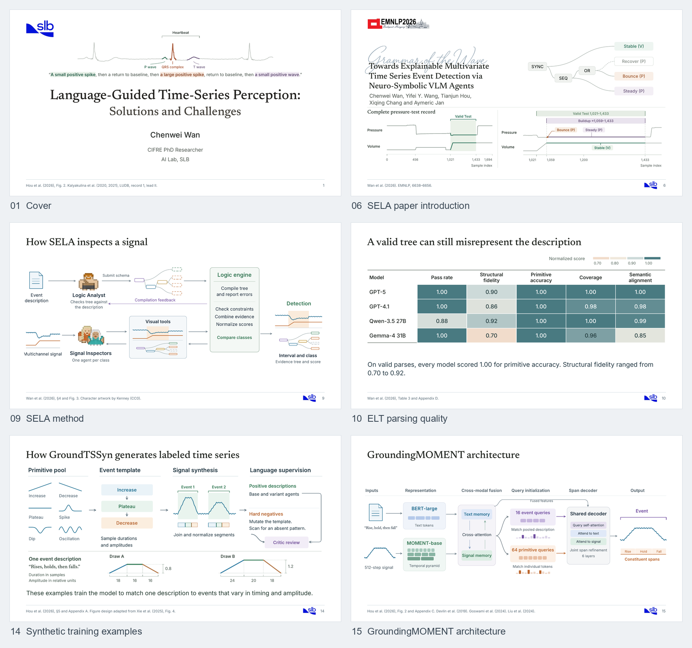

# Examples for v0.2.0

[All examples](../README.md) | [Release v0.2.0](https://github.com/cw-wan/elegant-academic-slides-skill/releases/tag/v0.2.0)

This archive accompanies repository release **v0.2.0**, based on the submitted package **`design-academic-slides_v2026.11.25.3.zip`**. The source skill identifies itself as **edition v2026.11.25.3**. Repository release numbers and source edition labels are recorded separately.

| Example | Included files | Design record |
| --- | --- | --- |
| [SLB AI Lab Webinar: Language-Guided Time-Series Perception](slb-webinar-2026-11-25/README.md) | 23-slide PPTX, 23-page PDF, six preview PNGs, file manifest | Seminar v10, 25 November 2026 |

The original PPTX, PDF, and design document are preserved. The [example record](slb-webinar-2026-11-25/README.md) and [manifest](slb-webinar-2026-11-25/example.json) identify the submitted files and publication checks. A full agent execution log or deck-generation script was not supplied.
