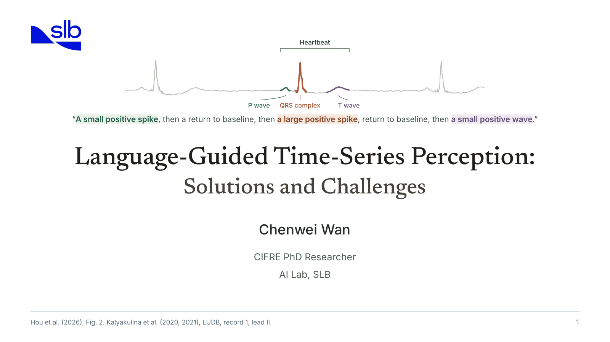
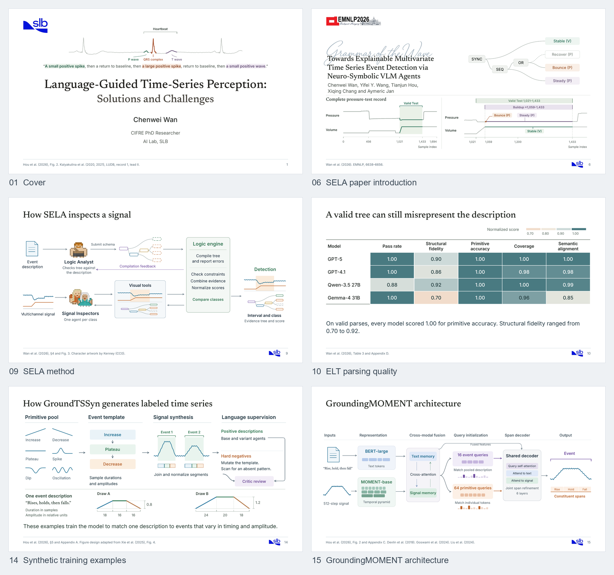
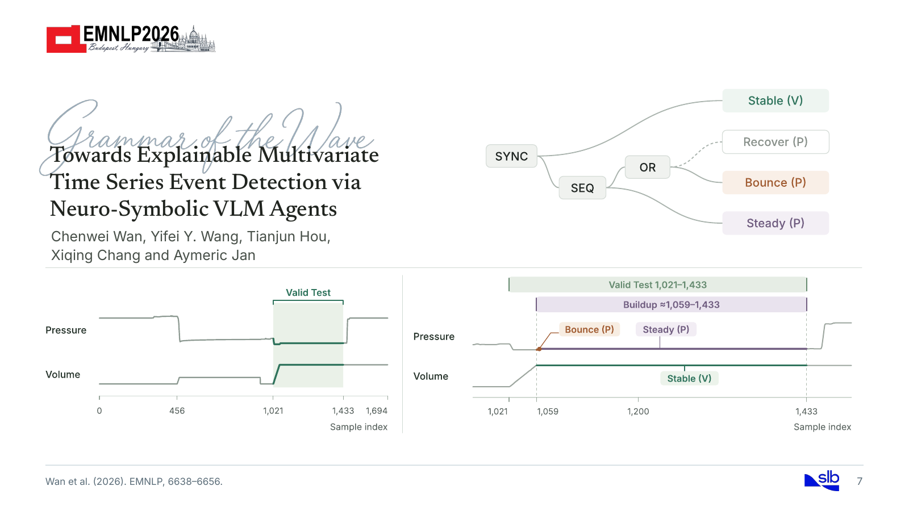
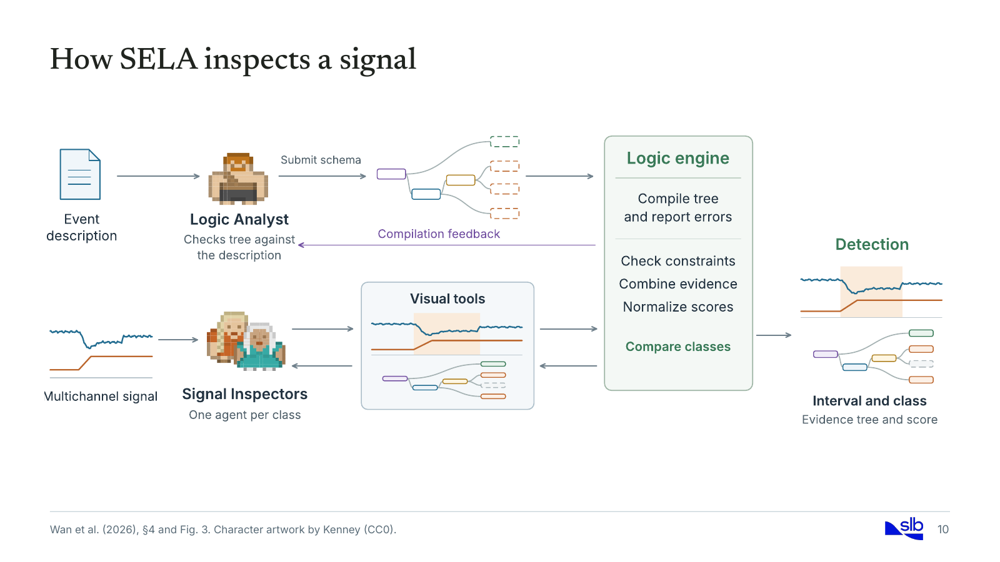
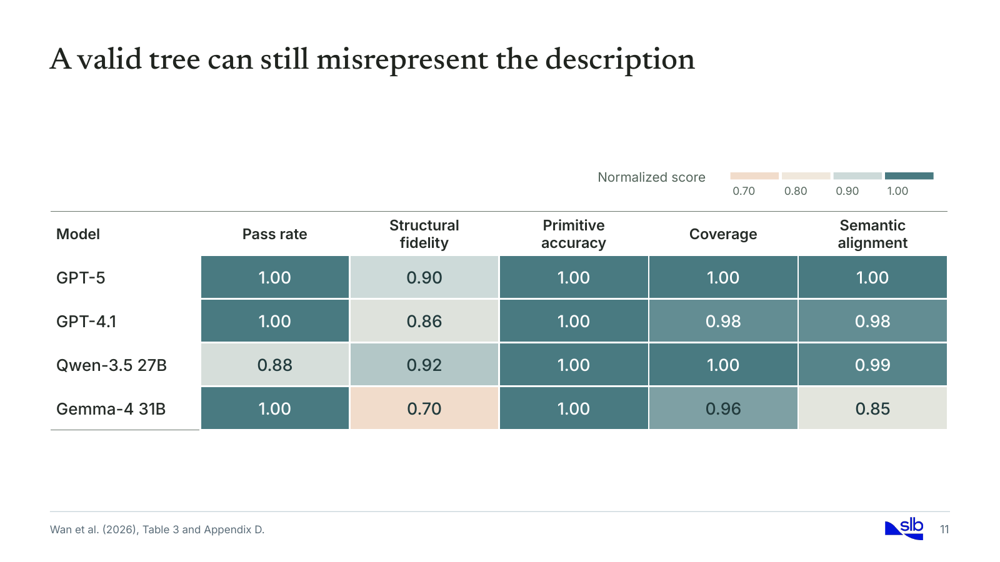
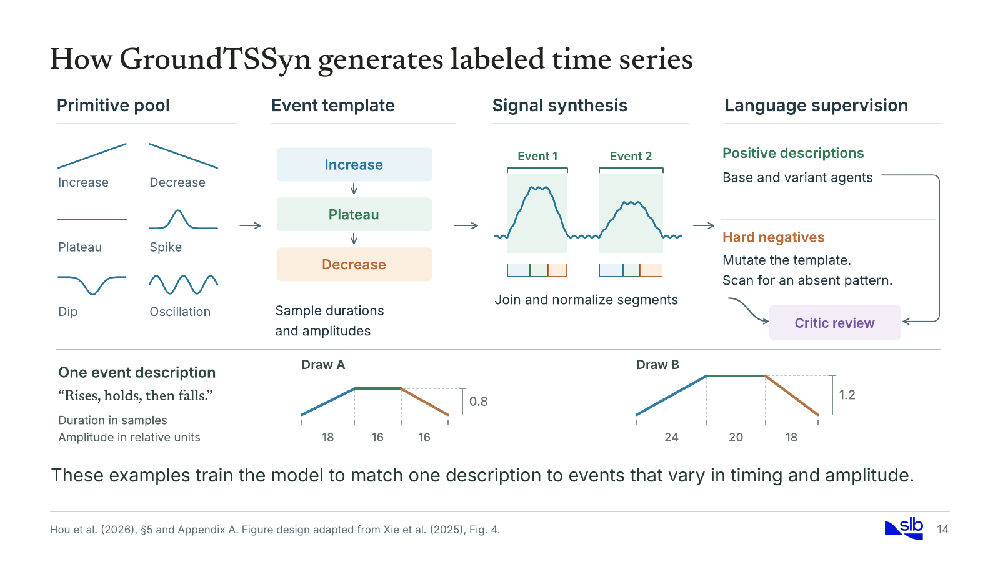

# Language-Guided Time-Series Perception: Solutions and Challenges

[Version archive](../README.md) | [All examples](../../README.md) | [Resources](../../../docs/resources.md)

**Chenwei Wan | SLB AI Lab Webinar | 25 November 2026 | 23 slides | English**

This supplied seminar connects language-guided time-series perception to SELA, GroundTSSyn, and GroundingMOMENT, then develops research directions for multichannel detection and event-based decision support. It demonstrates scientific storytelling, time-series annotation, method diagrams, result comparisons, and consistent typography.

## Files

| File | Use |
| --- | --- |
| [Download PowerPoint](SLB-Webinar-261125.pptx?raw=true) | Supplied PPTX with notes, native tables, and embedded demonstrations |
| [View PDF](SLB-Webinar-261125.pdf) · [Download PDF](SLB-Webinar-261125.pdf?raw=true) | Static 23-page export |
| [Design and source record](Seminar_Writing_Design_and_Sources_v10.md) · [Download Markdown](Seminar_Writing_Design_and_Sources_v10.md?raw=true) | Original v10 record and prior design decisions |
| [File manifest](example.json) | Version association, file hashes, selected preview pages, and package counts |
| [External resources](../../../docs/resources.md) | Design record's external skills, papers, data, fonts, and presentation references |

## Version and provenance

| Field | Value |
| --- | --- |
| Repository release | [v0.2.0](https://github.com/cw-wan/elegant-academic-slides-skill/releases/tag/v0.2.0) |
| Associated source skill edition | v2026.11.25.3 |
| Submitted package | `design-academic-slides_v2026.11.25.3.zip` |
| Design record | `Seminar_Writing_Design_and_Sources_v10.md` |

The PPTX, PDF, and design document were submitted together and are preserved without content changes. Their association with this release does not establish the exact agent run or skill revision that generated the deck: a full generation log or build script was not provided. The design record calls itself v10; the PPTX does not contain an explicit v10/v11 label.

## Preview

Images are rendered directly from the supplied PDF. Click to open at full resolution.

Selected slides at full size

### Slide 6: SELA paper introduction

### Slide 9: SELA method

### Slide 10: ELT parsing quality

### Slide 14: Synthetic training examples

## What to learn from the example

- Introduce the research question through a concrete pressure-test task.
- Preserve authorship, research citations, and the source paper's vocabulary.
- Connect descriptions to measured intervals with a logic tree and aligned time axes.
- Distinguish modules, data, outputs, and feedback in method diagrams.
- Show timing and amplitude changes on common scales in paired synthetic examples.
- Keep metric names, units, and experimental context in result comparisons.

## Package checks and limits

| Item | Observed in the supplied files |
| --- | --- |
| Slides and PDF pages | 23 PPTX slides and 23 PDF pages, widescreen |
| Speaker notes | 23 notes pages |
| Native tables | 3, on slides 10, 21, and 22 |
| Embedded video | 3 MP4 files, referenced by slides 11, 16, and 17 |
| SVG assets | 17 distinct embedded SVG files and 17 SVG references |
| Font data | 5 embedded font files; font names include Newsreader and Inter families |
| Integrity | PPTX ZIP check passed; all PDF pages rendered |

The original design record says 18 embedded SVG figures. The supplied PPTX contains 17; slide 6 carries its combined Event Logic Tree and nested-interval figure as PNG. The historical document remains unchanged, and this README records the difference. The complete editable-figure archive and font-license package mentioned in that record were not supplied. The skill's [six SVG examples](../../../skills/design-academic-slides/assets/examples/) are selected figures, not the complete source archive.

PDF and PNG previews are static. Video embedding was inspected, but playback, animations, PowerPoint editing, and a full rebuild were not tested during repository publication. Research sources are attributed in the design record; publication checks do not reproduce the experiments.
