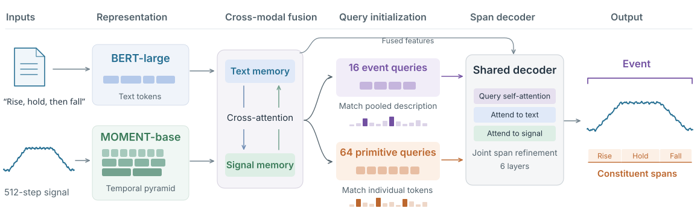
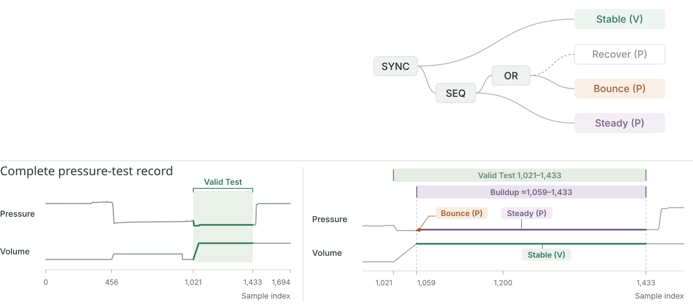
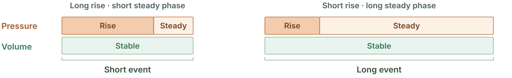
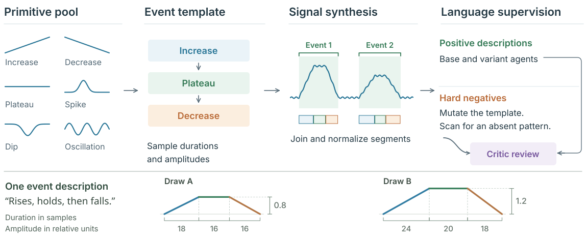
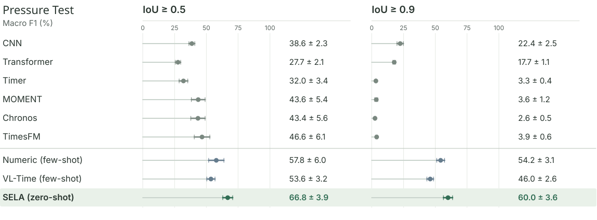
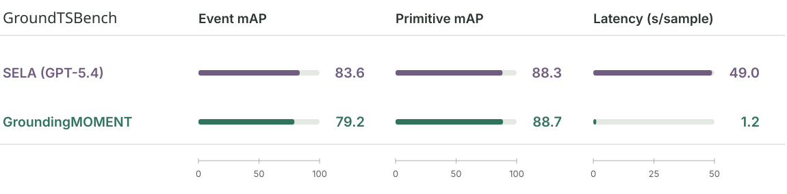

# 学术与工业研究报告制作手册

**Design Academic Slides · v2026.11.25.3**

阅读顺序：① 使用入口　② Seminar 叙事　③ 文字与批注　④ 架构图　⑤ 事件区间　⑥ 时间尺度　⑦ 合成训练数据　⑧ 实验比较　⑨ 审阅交付　⑩ 来源与维护。

## 1. 拿到论文、已有 PPT 或一轮批注后

先确定听众在听完报告后应当能回答什么。工业研究听众往往熟悉现场操作，却未必知道论文怎样定义任务。以压力测试为例，先问“你会把测试区间画在哪里？”听众就会带着一个实际判断去理解后面的指标和方法。把这个问题写在备稿里，比先挑模板更有价值。

| 你手里有什么 | 工作起点 | 第一份有用的产出 |
|---|---|---|
| 一篇论文或几篇相关工作 | 找到共同问题、权威论文版本、关键数据和演讲场景 | 逐页大纲，每页写明听众的问题、证据和与下一页的联系 |
| 一份已经认可的演示稿 | 找封面、方法页、结果最密集的一页，核对布局、字级和图表约定 | 一组可复用的版面尺度，以及必须保留的科学内容 |
| 已有版本和框选批注 | 打开实际审阅页，读选区、正文与回复，定位到对象 | 一份私下使用的修改清单，每条对应一个可观察的验收结果 |

**调用方式。** 已安装时，可直接点名 `$design-academic-slides`。使用压缩包时，解压后保留 `design-academic-slides/` 的目录结构，选取其中的 `SKILL.md` 作为入口。它链接到各专题规范。六张 SVG 图例位于 `assets/examples/`，可以放大、修改标签或检查曲线连接。包内附有本手册的 Markdown 版。

**默认字体。** 主稿标题用 Newsreader，正文、表格、引用和图内标注用 Inter。若讲者另有指定，或主办方要求使用固定字体模板，按当次要求排版。

**可直接使用的任务描述**

> 用 $design-academic-slides 把这两篇论文整理成英文工业研究 seminar。听众了解业务，首次接触这个任务。先给我逐页大纲，写明每页要回答的问题、证据和引用。等我确认后，再制作可编辑的 PPTX 和可以框选批注的审阅版。

若任务只是修改一页，换成“以我刚批注的版本为底稿，读取所选对象和回复，完成后另存下一版”。真正要改的是一个图例时，通常无需重新规划整场报告。

## 2. 把几篇论文讲成一场报告

让听众先体验任务，再给任务命名。一个好案例要有足够上下文，使观众看得出来自己有可能判断错。沿着同一个问题介绍两项工作，第二篇的出场就有了理由。

| 报告段落 | 本次 seminar 的做法 | 可迁移的决策 |
|---|---|---|
| 问题与定位 | 在同一条压力、体积记录上找到事件，两个相似候选区同时可见 | 用一个会引起真实分歧的选择引出挑战 |
| 第一项工作 | 看事件树如何约束多通道判断，再看 agent 怎样读取信号、如何定位边界 | 把表示、执行、结果和具体病例排在能相互解释的位置 |
| 第二项工作 | 从逐个检查证据的成本过渡到直接预测事件与组成部分，随后播放原始 demo | 用部署条件或实测局限搭桥。论文介绍页单列全体作者和发表信息 |
| 研究方向 | 从“怎样实时定位多通道事件？”起手，先展示计划，再比较现有生成方法和所需监督 | 先让听众知道拟解决什么，再用一个案例解释差异 |

本场报告的收尾共三页。第一页在章节标题下用两行交代接下来的题目：用合成数据训练实时多通道检测器；用检测出的事件做推理、预测与决策支持。两行的顺序与随后两页一致。第二页把“定义事件规则 → 合成带标注的多通道数据 → 训练低延迟检测器”放在上方。下方比较生成器能控制什么，以及事件定位还需要哪些时序与逻辑约束。第三页把感知、推理、预测和决策支持各自需要的证据与检验方式对齐。参考文献另起一页。三页是本场报告的预算，其他场合按讲述任务决定。

**封面与署名。** 单人 seminar 的首页写讲者和经确认的职位、机构。一张可读的心电波形就能介绍“语言片段如何对应信号”。保留完整的短描述，仅给与 P 波、QRS 波群和 T 波有关的短语着色。进入具体论文时，按发表顺序列出全体作者，标清 venue 和 track。联合主讲、论文报告等场合按实际署名要求处理。

## 3. 哪些 comment 值得让听众看见

逐句判断：听众少看这句话，会认错哪一个对象、数值或结论？如果答案是一个具体对象，把标签直接放到对象旁。如果答案是核心判断，用正常正文字级把判断写清楚。其余文字按用途分配。

| 信息 | 放哪里 | 本次可借鉴的写法 |
|---|---|---|
| 区间、单位、分母、误差定义 | 对应标记、坐标或表头 | “Buildup ≈1,059–1,433”；“among valid parses”；“mean ± SD” |
| 观众应记住的实验发现 | 标题或主要阅读区 | 同一处说清 event mAP 的差值和每个样本的实测耗时 |
| 改变结论适用范围的条件 | 结论旁或列标题 | 跨阈值比较时明确每一列的 IoU，给同类面板同一刻度 |
| 值得口头补充的配置与背景 | 讲者备注 | 比较延迟时保留推理后端和设备信息；若讨论硬件效率，就把条件移到台面上 |
| 数据、论文或引用原句的出处 | 规范页脚和完整参考文献 | “Hou et al. (2026), Table 2 and Appendix D.” |
| 给制作者的修改要求 | 审阅批注或私下清单 | 用框选指向特定曲线或文字，写明想改变的对象 |
| 图中已经说清的解释 | 直接删去 | 表头已有“Latency (s/sample)”，其下无需再写一行灰字解释单位 |

**英语的判断标准。** 让句子的主语执行一个具体动作。讲输入输出时可直接说 “The detector returns a start and end time for each matching event.” 讲研究计划时用 “We propose …”。保留影响解释的限定，例如估读的起点和只在有效解析中统计的正确率。把反复自证、空泛的重要性判断和讲述制图过程的句子删去。最后朗读一遍，听众应当可以一边听，一边指向图中对应的位置。

**两条标签也可以各有用处。** 短事件和长事件是对整段时间的判断，Rise 和 Steady 的长短则描述段内构成。若删除其中一层，听众就会少读出一个事实。章节标题下的导读也可以用同一个问题判断：这行话能否让听众预知下一页的具体问题？

**删除要删到源头。** 检查幻灯片文字框、SVG 内部、位图底部和图下空白四处。只删掉 PPT 中的一层文字，嵌在图片里的副本仍会出现在下一次导出中。

## 4. 架构图先独立成图，再放进 PPT

先从方法定义画出信息的去向，再选择形状。输入是文本和时间序列，就让它们各自沿着清楚的路径进入编码器；融合发生在方法规定的位置。观察参考论文的分组、线宽、token 或序列的缩略表达和阅读顺序，再决定本图需要哪些视觉元素。

**图 1. GroundingMOMENT 架构。** 观察文字和信号在哪里交汇，event query 与 primitive query 如何进入同一个 decoder，以及图的最右侧怎样把两种输出画成区间。图源为本次 seminar 第 15 页，方法见 [Hou 等人的论文](https://aclanthology.org/2026.findings-emnlp.229/)。

| 检查位置 | 应能作出的判断 |
|---|---|
| 左端与右端 | 观众能说出系统收到什么、最后返回什么 |
| 模块和中间对象 | 编码器名称来自原文，输入 token、信号特征、查询和输出可以从图形及标签上识别 |
| 连线和分组 | 箭头指向真正消费该信息的模块，包围线具有共享范围或重复层的含义 |
| 插入后的实际尺寸 | 模块名、箭头终点和最小标签能在投影尺度读清，所有说明与图中真实对象对应 |

保存保留文字与曲线的 SVG；独立渲染检查后，再按原比例插入 PPT。需要兼容不同渲染器时，为嵌入版提供匹配的预览图，交付的 SVG 保留可编辑文字。PPT 中的数字表格优先使用原生单元格。图形可编辑和数值可编辑各有对应的源文件。

**原图与叠印。** 案例旁的工程师取自原版 SELA PPTX。裁剪时保留头盔、面部和工服的颜色、轮廓及透明边缘，在最终大小下和原图对照。论文介绍页则让淡色的 “Grammar of the Wave” 图案叠在深色标题首行后方。标题在前，可编辑；作者与会议信息各自清晰。检查透明度和叠放顺序时，要看整页渲染。

**版面尺度。** 可以从认可稿中抽取一组真实值。本场 seminar 第 18 页的标题约为 29.3 pt，实验结论约为 18.5 pt，页脚出处约为 10.2 pt。主稿的标题用 Newsreader，正文和图表标注用 Inter。本场用 Newsreader Medium 排标题，用 Inter 的 Regular、Medium 和 SemiBold 区分正文与强调。在目标尺寸下检查标题断行、表头和最小图注。

## 5. 同一事件怎样在句子、树和信号中对得上

先找一个完整事件，保留起止边界以及前后足够的记录。想展示歧义时，同一总览中至少应辨认得出两个合理候选。需要读局部形状时，再把目标区间放大，并让观众知道放大了原图的哪一段。

**图 2. Valid Test 与 Buildup。** 下方左侧展示完整记录，右侧在同一坐标轴上为父事件和子事件各设一条区间带。Valid Test 的 1021–1433 来自专家标注；Buildup 起点约 1059，是根据曲线读出的解释。图中保留了这个差别。依据为 [KITE 记录](https://github.com/cw-wan/SELA/blob/main/data/PressureTest/timeseries/PT_46710318.csv) 和 [专家标签](https://github.com/cw-wan/SELA/blob/main/data/PressureTest/labels.csv)。

**树。** 按真实拓扑从左向右铺开，各终端叶子即使深度不同也落在同一右列。相同角色使用一致的尺寸，连线以柔和曲线到达正确的子节点。保持未选分支可辨；一个实例只激活一个分支时，仍应保留算子本身的语义。

**对应关系。** 在压力曲线上标出 Bounce、Steady，在体积曲线上标出 Stable。树叶与曲线片段共享颜色和标签，读者在黑白打印时也能跟上。保持各通道采样索引一致。真实信号保持原值，改变持续时间用来解释理论弹性时另画示意图并标明性质。

## 6. 怎样同时读出事件总时长和阶段比例

“哪个事件更长？”和“哪个事件的上升阶段占比更高？”需要分别从图中读出。ELT 定义的是事件的组成关系和跨通道约束，同一种关系可以对应不同的时长组合。

**图 3. 同一种事件逻辑的两种持续时间。** 两个面板横向每单位距离代表相同的时间。短事件的上升阶段约占 70%，长事件约占 24%。这两个比例用来解释拓扑弹性；它们来自示意图的绘制参数。稳定的体积信号贯穿各自完整事件。理论依据见 [Wan 等，第 3 节](https://aclanthology.org/2026.emnlp-main.290/)。

| 听众要读出的事实 | 画法 | 验收问题 |
|---|---|---|
| 整个事件持续多久 | 保留共同时间尺度，用下方括线标两端 | 遮住文字后，能否指出哪个事件占用更长时间？ |
| 每个阶段占多大比例 | 转折点落在各自总跨度的正确位置，在上方写明两段的相对长度 | 较短事件是否上升段更长？较长事件是否平台段更长？ |
| 两个通道如何同时满足事件定义 | Stable 与该事件的起止端点对齐 | 能否沿体积通道从压力开始上升一直看到平台结束？ |

如果一轮批注要求“在下面加 Short event 和 Long event”，这是给现有图增加总时长信息。回看上方阶段标签是否仍在，再逐项验证三种读法。评审时最好直接说出哪一个读法仍然有歧义。

## 7. 一句事件描述，怎样训练出对不同波形的识别能力

先钉住语义，再决定图上哪些量可以变。一条 “Rises, holds, then falls.” 对应上升、平台、下降三个有序片段。同一模板的两次绘制足以让听众看出生成机制怎样提供训练对。

**图 4. GroundTSSyn 如何构造语言监督。** 上方交代 primitive、模板、信号合成与语言监督的关系。下方两条曲线使用共同的时间和幅度尺度。水平标记给出每段的采样点数，竖直标记从基线量起。两次示意抽样分别为 18／16／16 和 24／20／18 个采样点，上升幅度分别为 0.8 和 1.2，单位为归一化前的相对幅度。[Hou 等，附录 A.2，第 4824–4825 页](https://aclanthology.org/2026.findings-emnlp.229/)。

**生成顺序。** 先取事件总时长并分配给各阶段，再在规定范围内采样幅度。生成同一事件的变体时，可在约束范围内扰动参数，重新合成并检查约束。标明每个量究竟是时长还是幅度，读者才能把数字和曲线对上。

**说清训练目的。** 可以写 “These examples train the model to match one description to events that vary in timing and amplitude.” 把检测性能、跨域泛化等实验结论留给对应的结果页。方法页的空间优先用于说明训练信号如何产生。

## 8. 结果图让听众比较什么

**图 5. 严格定位阈值的比较。** 在同一行横向看一个方法，在同一列纵向看一组方法。两个面板共享 0–100 范围、行序与数值精度；点表示均值，须线表示论文报告的标准差。图例来自 [Wan 等，表 2、4、5](https://aclanthology.org/2026.emnlp-main.290/)。

**图 6. 准确度与耗时。** 两列 mAP 共用尺度，延迟另用秒／样本。表头、方法、图形和右侧数值在同一行。GroundingMOMENT 的 event mAP 为 79.2，SELA 为 83.6，相差 4.4 分；同一张表报告的两者耗时分别为 1.2 和 49.0 秒／样本。保留各自实验后端，解释这组数值的适用条件。依据为 [Hou 等，表 2 与附录 D](https://aclanthology.org/2026.findings-emnlp.229/)。

**何时用表。** 精确值、分母和多个解析质量维度需要一起阅读时，原生表格便于查看与修改。对可比较数值采用统一且写明上下限的色标；每格仍需印出精确值。准确度、延迟及方向不同的指标分别编码。来源没有报告误差时，保留点估计。

**原生热表怎样验收。** 本报告第 10 页的六列等宽，表头与数据行等高。表头在词组边界换行，单元格内边距统一，色标旁标出范围。先用最长表头定行高，再读取 PPT 原生表格的六个列宽，最后检查投影尺寸下的换行和精确值。其他表若方法名称明显更长，可单独给标签列留宽。

## 9. 从一条框选批注到可继续审阅的新版本

1. **锁定版本和对象。** 打开用户实际批注的审阅版，读取完整讨论串及回复。“去掉”可能只指 logo 旁的一行字。先用锚定对象和可见内容确认范围。
2. **写出可观察的改动。** “图再清楚一点”可以落实成“让父子区间分别占一行，两者使用相同的横轴，三个 primitive 就地标注”。保留用户没有要求改动的科学数据。
3. **处理连带关系。** 删页后更新页码、备注、目录和交叉引用。更改全局页脚时，同时检查双位数页码、最长引用、章节页和参考文献页。
4. **检查展示文件。** 逐页渲染并细看改动区域。检查作者、输入输出、图表单位、活动分支、字体及区间端点。打开 PPTX 核对原生表格、源图、备注、媒体与链接。若只验证视频已嵌入，交付说明应如实描述。
5. **检查审阅面。** 打开下一版审阅页，确认能选对象并留言。核对它和 PPTX 的页数与版本号、标题换行和关键图是否一致。审阅图可整图框选，修改图内单个标签时用配套 SVG。
6. **交付。** 首先给可框选的审阅入口，然后给带版本号的 PPTX。若约定交付 PDF，从同一份最终 PPTX 导出，逐页核对页序、字体、叠印、表头和视频静帧。按项目约定附可编辑图源及使用记录。修改摘要按实际页码写，用户可以直接找到。

**下载后提示缺字体怎么办？** 保留使用 Newsreader 和 Inter 的可编辑主稿。按弹窗中的字族和字重核对字体文件、渲染器实际加载的字形、PPT 主题与嵌入记录，再用目标 PowerPoint 修改标题和表格、另存并重开。若接收方仍需在缺字体的电脑上编辑，可另存带有 `Windows-compatible` 后缀的副本。本场兼容副本以 Times New Roman 排标题、Arial 排正文。下一轮沿用最新内容和批注，主稿继续使用 Newsreader 和 Inter。

**一次本地修改怎样验收？** 本场报告的封面采用讲者姓名、职位和机构，后续页在页码左侧放同一枚 SLB 标志。可以逐页数标志、检查最长引文有无碰撞，并把正文区域与上版渲染对比。这样既能验收重复元素，也能发现一处页脚变动意外影响了正文。换到另一家公司时，使用该场合认可的标志和摆放规则。

## 10. 借鉴了什么，以及怎样继续维护

| 来源 | 这套方法实际采用的部分 |
|---|---|
| [Elegant Academic Slides](https://github.com/cw-wan/elegant-academic-slides-skill) | 沿用原有学术演示规范，保留科学结构、作者归属及被认可的设计 |
| [Scientific Writing](https://github.com/K-Dense-AI/scientific-agent-skills/blob/main/skills/scientific-writing/SKILL.md) | 对齐结论、指标、条件和证据，保留科学上必要的限定 |
| [Writing Clearly and Concisely](https://github.com/obra/the-elements-of-style/blob/main/skills/writing-clearly-and-concisely/SKILL.md) | 用具体动词精简英文，让听众能跟着一句话找到对象 |
| [Humanizer](https://github.com/blader/humanizer/blob/main/SKILL.md) | 清理模板化开场、重复的保证和防御性修饰，同时保留作者的表达 |
| [Academic Diagram](https://github.com/plbbl/academic-diagram-skill/blob/main/SKILL.md) | 提炼参考图的视觉语法，先独立绘制并检验可编辑架构图 |
| Presentations | 实施 PPTX 和审阅版，核对原生对象、字体、媒体、备注和导出 |
| PDF | 逐页核对字体和矢量图、比较 PPTX 导出的静态页面，并检查中文手册 |
| Skill Creator | 组织入口、按需加载的专题规范、可验证和可分发的版本 |

**图表案例。** Anthropic Economic Index 的并排图启发了面板对齐、共享尺度与紧邻数据的类别名；语言模型追踪研究用固定结构比较改变的条件，适用于解释多通道生成规则中保持不变的约束；职业类别图启发了按行列对齐任务、证据与指标的研究路线表。[Economic Index 报告](https://www.anthropic.com/research/anthropic-economic-index-september-2025-report) · [Tracing the thoughts of a large language model](https://www.anthropic.com/research/tracing-thoughts-language-model) · [Economic Index 首篇报告](https://www.anthropic.com/research/the-anthropic-economic-index)

**演讲编排。** 封面署名和工业问题的引入参考了 [Jeff Dean 的 CIKM 报告](https://research.google.com/people/jeff/CIKM-keynote-Nov2014.pdf) 和 [Rob Hyndman 的 Zalando seminar](https://robjhyndman.com/seminars/fr_overview.html)。围绕一项问题安排证据，还可对照 [Fei-Fei Li 的视觉识别演讲](https://www.ted.com/talks/fei_fei_li_how_we_re_teaching_computers_to_understand_pictures)、[Michael Alley 的教学材料](https://writing.engr.psu.edu/assertion_evidence_EA.html) 和 [Yann LeCun 的 Berkeley 报告](https://eecs.berkeley.edu/research/colloquium/220927-2/)。包内的 `references/sources.md` 逐项登记贡献及图源。

**维护方法。** 新增一条规范前，指出它在哪张最终页或哪条明确要求中得到验证，再判断它是通用原则、带前提的技术，还是本项目的约定。把它写到唯一权威的专题文件，同时检查入口、中文手册和图例。设计被后续决定替换时，直接更新所有会被读者当成现行做法的位置。项目修改经过保留在独立记录中，使用手册只讲现在采用的做法。
